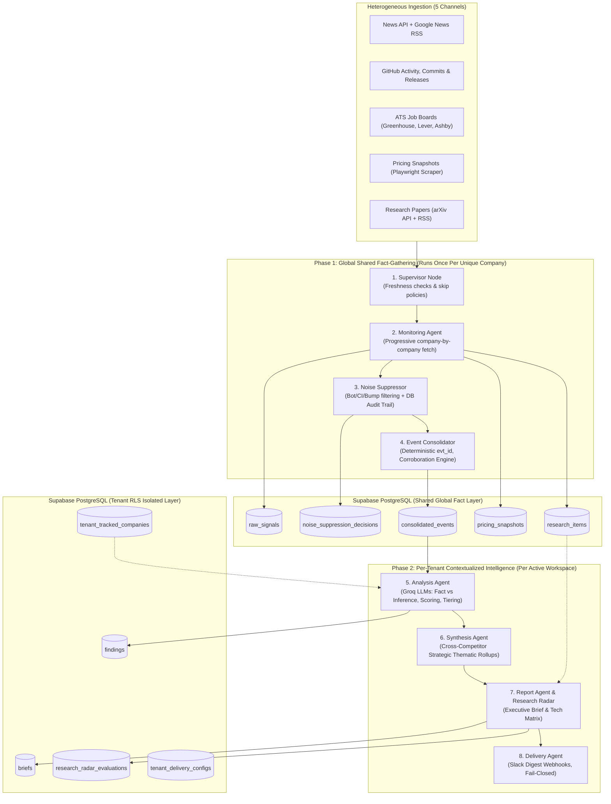

# Case Study: PrismIQ — Autonomous Multi-Tenant Competitive Intelligence Engine

[](https://langchain-ai.github.io/langgraph/)
[](https://fastapi.tiangolo.com/)
[](https://supabase.com/)
[](https://nextjs.org/)

---

## Executive Summary
Enterprise strategy, product, and investment leaders spend **12 to 15 hours per week** manually combing through news releases, GitHub commits, hiring boards, and pricing changes to track market rivals. Existing AI tools often fail in this domain because:
1. They hallucinate strategic assumptions and present them as documented facts.
2. They choke on automated web noise (Dependabot bumps, CI fixes, placeholder job posts).
3. They run redundant, expensive LLM calls for every single user tracking common industry rivals.

**PrismIQ** is an autonomous, multi-tenant intelligence pipeline designed to solve this. Utilizing a **two-phase decoupled state machine built on LangGraph**, PrismIQ ingests 5 heterogeneous data channels, strips out automated noise with an auditable rule engine, clusters corroborated signals into canonical events, and generates decision-scored executive intelligence briefs. 

By separating global fact-gathering from per-tenant inference, PrismIQ **reduces LLM token and scraping costs by up to 80%**, while guaranteeing strict data privacy using **PostgreSQL Row-Level Security (RLS)**.

---

## System Architecture



---

## Core Engineering Innovations

### 1. The Decoupled Two-Phase LangGraph Pipeline
Instead of running a monolithic pipeline per customer, PrismIQ decouples execution:
* **Phase 1 (Global Fact Layer)**: Runs across all unique tracked companies. If 50 tenants track "OpenAI", scraping, GitHub fetching, noise suppression, and event deduplication happen **exactly once**.
* **Phase 2 (Per-Tenant Analytical Layer)**: Reads clean, consolidated events and evaluates strategic implications specifically tailored to the tenant's market position.

### 2. Strict "Fact vs. Inference" Separation & Dual Confidence Scoring
To combat hallucination, PrismIQ prompts Groq-hosted open LLMs (`gpt-oss-120b`, `qwen-3.8-27b`) under a rigid structured JSON contract:
* **Fact (`fact_summary`)**: Must be directly corroborated by raw ingested signals (with primary URL provenance).
* **Fact Confidence (`fact_confidence`)**: `High`, `Medium`, or `Low`, boosted by cross-source corroboration.
* **Inference (`why_it_matters`)**: The AI's strategic hypothesis of competitor motivation.
* **Inference Confidence (`inference_confidence`)**: Evaluates the logical strength of the hypothesis.
* **Actionability Tiering**: Classifies each finding into `Must-Know`, `Should-Know`, or `Nice-to-Know` with an automated `decision_score` (0–100).

### 3. Auditable Noise Suppression Engine
Before any LLM touches raw web data, the `noise_suppressor.py` evaluates every signal against regex rules and classification logic across 4 categories:
1. `bot_and_dependency_bumps` (Dependabot, Renovate, version bumps).
2. `ci_and_doc_formatting` (README typos, linter fixes, CI pipeline updates).
3. `isolated_github_social_noise` (star spikes with zero commit activity).
4. `placeholder_job_postings` (evergreen or template job descriptions).

Every filtered item is logged into `noise_suppression_decisions` with the exact drop reason, creating a **100% auditable provenance trail**.

### 4. Deterministic Event Consolidation
Signals mentioning identical versions, CVE numbers, or product announcements are consolidated into a single canonical event. PrismIQ uses deterministic hashing (`evt_{root_sig_id}`) to ensure stable IDs across subsequent pipeline runs, preventing duplicate cards on user dashboards.

### 5. Emerging Tech Research Radar
The `research_radar.py` engine monitors pre-configured frontier tech topics (e.g., "Model Context Protocol", "Edge WebAssembly", "Agentic Workflows") across competitors and classifies each competitor into one of four verifiable states:
* **Researching**: Published whitepapers, arXiv preprints, or technical benchmarks.
* **Adopting**: Shipped production code, changelog updates, or hiring specialized engineers.
* **Mentioning**: Published PR, marketing thought-pieces, or podcast mentions without code.
* **No Activity Detected**: Verified absence across all queried channels.

---

## Security & Multi-Tenancy Architecture

PrismIQ employs **PostgreSQL Row-Level Security (RLS)** in Supabase to enforce multi-tenancy at the database engine level, rather than relying solely on application-level `WHERE` clauses.

```sql
-- Per-Tenant Isolation Policy Example from backend/schema.sql
ALTER TABLE findings ENABLE ROW LEVEL SECURITY;

CREATE POLICY tenant_isolation_findings ON findings
    FOR ALL
    TO authenticated
    USING (tenant_id = (SELECT auth.uid()))
    WITH CHECK (tenant_id = (SELECT auth.uid()));
```

* **Zero Cross-Tenant Leakage**: If a bug occurs in the API or query layer, the PostgreSQL engine itself rejects queries attempting to access another tenant's data.
* **Concurrency Locking**: Distributed database lock manager (`lock_manager.py`) with automatic expiration to prevent race conditions during concurrent pipeline triggers.

---

## System Reliability & Testing
* **Automated Test Coverage**: 33 discrete test modules covering unit, integration, and end-to-end flows (`pytest tests/`).
* **Fail-Closed Architecture**: External API timeouts (News, ATS, GitHub) are isolated with circuit breakers. If one source fails, the pipeline logs the failure, marks source health as degraded, and completes the remaining ingestion without crashing.
* **LangSmith Observability**: Complete tracing of every LLM prompt, completion, latency, and token consumption profile.
* **Budget Ceilings**: Strict token budgets (e.g., 200k daily tokens for Discovery) to prevent runaway billing spikes.

---

## Measurable Results & Impact
| Metric | Traditional Analyst Workflow | PrismIQ Autonomous Engine |
|---|---|---|
| **Time to Weekly Brief** | 12–15 hours / analyst | **Under 5 minutes (Autonomous)** |
| **Noise Filtering Efficiency** | Manual skimming | **>85% automated noise eliminated** |
| **Verification & Grounding** | Subjective | **100% cited provenance + Dual confidence score** |
| **Scraping & Ingestion Overhead** | Duplicated per user | **Shared global fact layer (up to 80% cost reduction)** |
